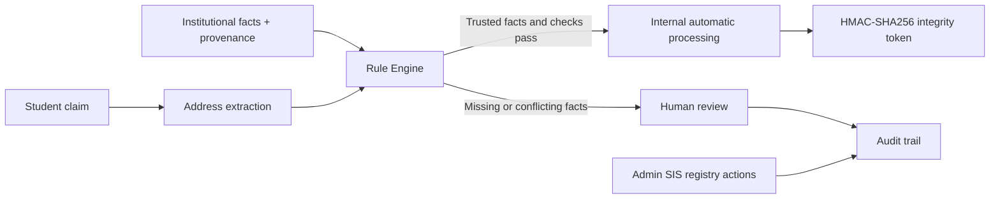

# EDUASSISTANT Architecture

## Supported workflow

`MILITARY_SERVICE_CONFIRMATION` is the single domain: an internal workflow for a student-status confirmation used to support military-service deferment paperwork. The application does not determine legal eligibility or represent a decision by a military authority.

## Trust boundaries

- `EXTERNAL_INSTITUTIONAL_SIS` plus `EXTERNAL_VERIFIED` is the external trust path for a future connector. No such connector currently exists.
- `INTERNAL_DEMO_SIS` plus `ADMIN_VERIFIED_DEMO` is accepted only when `ALLOW_ADMIN_VERIFIED_DEMO_SIS=true`. In production this setting defaults to false. The label means Admin checked internal demo facts, not that a university SIS verified them.
- `SYNTHETIC_TEST_SIS` plus `TEST_VERIFIED` is accepted only under an explicit `DETERMINISTIC_TEST` evaluation context. Production request handlers never set that context.
- Missing provenance, `UNVERIFIED`, and `LEGACY_ACCOUNT` records escalate as `FACT_UNKNOWN`.

## AI provenance

The address service tries Google Gemini first, then OpenRouter when configured. Responses include the provider, model, whether an API call was attempted, attempt count, and fallback state. Deterministic parsing of a real address is reported as a parser fallback, not as synthetic input.

AI confidence is a model-generated score, not a calibrated probability. The Rule Engine owns workflow routing; AI does not decide policy or legal eligibility.

## Deterministic evaluation

- Verify Harness: 9 in-memory Rule Engine cases. It performs no network calls, database reads/writes, global AI-mode changes, or threshold mutation.
- Track A Decision Benchmark: 18 fixed synthetic scenarios. `benchmark/run_benchmark.py` performs no AI calls or network access and writes only the local `benchmark/results/latest.json` and `.csv` artifacts.
- Live AI E2E check: `benchmark/run_live_ai_eval.py` runs five address examples separately. It does not alter Track benchmark metrics.

The five escalation categories are the taxonomy implemented by Team 1; they are not claimed as mandatory Hackathon category names.

## Thresholds and human review

The adaptive threshold remains 0.75 by default, bounded by 0.65 and 0.90 with a 0.02 step. `MISSED_ESCALATION` adds 0.02, `UNNECESSARY_ESCALATION` subtracts 0.02, and `CORRECT` leaves it unchanged. Reviewer actions remain `APPROVE`, `REJECT`, `REQUEST_INFO`, `OVERRIDE`, and `STOP`; overrides require a reason and are audited.

## HMAC and public verification

HMAC-SHA256 authenticates the integrity of stored case fields using a shared secret. It is not a PKI signature or legal digital signature. The public `/verify` page checks the HMAC value and displays whether the stored data matches.
